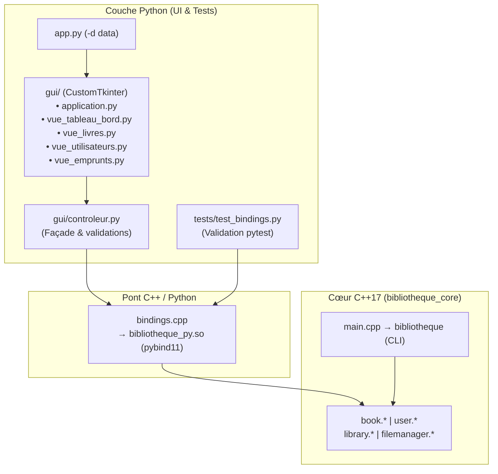

# Plan d'implémentation — Interface graphique Python (CustomTkinter) + C++ (`pybind11`)

## Objectif

Exposer la logique métier C++17 existante de l'application `bibliotheque` (`Book`, `User`, `Library`, `FileManager`) à Python via **`pybind11`**, valider rigoureusement cet interfaçage par des tests automatisés, puis construire par petites étapes testables une interface graphique en français avec **CustomTkinter** — tout en conservant l'exécutable console C++ existant (`bibliotheque`).



---

## Prérequis et points techniques

- **Dépendance système (`python3-tk`)** : CustomTkinter repose sur `tkinter`. Installer `python3-tk` si absent :
  ```bash
  sudo apt-get update && sudo apt-get install -y python3-tk
  ```
- **Environnement Python dédié (`agent/.venv`)** : installer `pybind11`, `customtkinter` et `pytest`.
- **Sécurité mémoire dans `pybind11`** : `Library` possède ses `Book` et `User` via `std::unique_ptr`, tandis que ses accesseurs (`findBookByISBN`, `getAllBooks`, `searchBooksByTitle`, `getAllUsers`, etc.) retournent des pointeurs bruts (`Book*`, `User*`, `vector<Book*>`). Tous ces bindings doivent utiliser `py::return_value_policy::reference_internal` pour empêcher Python de libérer la mémoire appartenant à `Library`.
- **Correctif `FileManager::createBackup()`** : déjà corrigé dans `filemanager.cpp` avec `filesystem::copy_options::overwrite_existing`.

---

## Découpage en étapes incrémentales et testables

### Étape 1 — Environnement & Prérequis
- Installer `python3-tk` sur le système.
- Créer un environnement virtuel dans `agent/.venv` et installer `pybind11`, `customtkinter`, `pytest`.
- Mettre à jour `.gitignore` pour ignorer `.venv/`, `__pycache__/`, `*.so`, `.pytest_cache/`.
- **Validation** : `.venv/bin/python -c "import tkinter, customtkinter, pybind11, pytest"` réussit sans erreur.

---

### Étape 2 — Refactoring CMake & Module `pybind11` (`bibliotheque_py`)

- **Modifier `CMakeLists.txt`** : remplacer le `file(GLOB SOURCES "*.cpp")` global par :
  - `bibliotheque_core` : bibliothèque (`book.cpp`, `user.cpp`, `library.cpp`, `filemanager.cpp`) en C++17 avec `POSITION_INDEPENDENT_CODE ON` et `-Wall -Wextra -Wpedantic`.
  - `bibliotheque` : exécutable CLI existant (`main.cpp` + `bibliotheque_core`).
  - `bibliotheque_py` : module Python via `find_package(pybind11 CONFIG REQUIRED)` et `pybind11_add_module(bibliotheque_py bindings.cpp)` lié à `bibliotheque_core`.
- **Créer `bindings.cpp`** exposant :
  - `Book` : constructeurs, getters/setters, `check_out`, `return_book`, `to_string`, `__repr__`.
  - `User` : constructeurs, getters/setters, `borrow_book`, `return_book`, `has_borrowed_book`, `get_number_of_borrowed_books`, `to_string`, `__repr__`.
  - `Library` : `add_book`, `remove_book`, `find_book_by_isbn`, `search_books_by_title`, `search_books_by_author`, `get_available_books`, `get_all_books`, `add_user`, `find_user_by_id`, `get_all_users`, `check_out_book`, `return_book`, `get_total_books`, `get_available_book_count`, `get_checked_out_book_count` (avec `py::return_value_policy::reference_internal` sur tous les pointeurs retournés).
  - `FileManager` : constructeur `(books_file, users_file)`, `save_library_data`, `load_library_data`, `file_exists`, `create_backup`.
- **Validation** :
  ```bash
  cmake -S . -B build -Dpybind11_DIR=$(.venv/bin/python -m pybind11 --cmakedir)
  cmake --build build
  ```
  Compilation sans erreur ni warning de `bibliotheque` et `bibliotheque_py*.so`.

---

### Étape 3 — Validation de l'interfaçage Python ↔ C++ (`pytest`)

- **Créer `tests/test_bindings.py`** (exécuté sur des copies temporaires `tmp_path` de `data/books.txt` et `data/users.txt`) :
  1. Chargement des fixtures et vérification des compteurs (41 livres, 25 utilisateurs).
  2. Gestion des livres : ajout, doublon ISBN, recherche par titre et par auteur (insensible à la casse), suppression.
  3. Gestion des utilisateurs : ajout, recherche par ID, liste des livres empruntés.
  4. Emprunts et retours : emprunt valide, cas d'erreur (déjà emprunté, ISBN/ID inconnu), retour et cohérence `Book`/`User`.
  5. Persistance et sauvegarde : cycle `save_library_data` → `load_library_data` sur une nouvelle instance, et `create_backup` appelé plusieurs fois.
  6. Stabilité mémoire : suppression de références Python + `gc.collect()` puis réutilisation de `Library` sans crash.
- **Validation** : `PYTHONPATH=build:. .venv/bin/pytest -v` passe à 100 %.

---

### Étape 4 — Couche Contrôleur & Squelette CustomTkinter

- **Créer `gui/__init__.py`**.
- **Créer `gui/controleur.py`** (`ControleurBibliotheque`) :
  - Encapsule `Library` et `FileManager`, charge les données depuis `data_dir`.
  - Valide les entrées utilisateur (champs vides, présence du caractère `|`, unicité ISBN/ID utilisateur) et retourne des résultats explicites en français `(bool, str)`.
- **Créer `gui/application.py`** (`ApplicationBibliotheque(ctk.CTk)`) :
  - Barre latérale de navigation (Tableau de bord, Livres, Utilisateurs, Emprunts), zone de contenu dynamique, barre d'état, sélecteur de thème (Clair / Sombre), sauvegarde à la fermeture.
- **Créer `app.py`** : point d'entrée acceptant `-d` / `--data-dir` (défaut `data`).
- **Validation** : tests unitaires de `ControleurBibliotheque` (`tests/test_controleur.py`) + ouverture de la fenêtre principale.

---

### Étape 5 — Sous-composants graphiques (Vues CustomTkinter)

Implémenter et vérifier chaque vue indépendamment :
- **`gui/vue_tableau_bord.py`** : cartes statistiques (total livres, disponibles, empruntés, utilisateurs) + boutons *Sauvegarder* et *Créer une sauvegarde*.
- **`gui/vue_livres.py`** : recherche par titre ou auteur, filtre *Tous* / *Disponibles*, liste défilante avec statut et suppression, formulaire d'ajout de livre.
- **`gui/vue_utilisateurs.py`** : liste défilante des utilisateurs et de leurs emprunts, formulaire d'ajout d'utilisateur.
- **`gui/vue_emprunts.py`** : section *Emprunter un livre* (livre disponible + utilisateur) et section *Retourner un livre* (liste des livres empruntés avec retour en un clic).

---

### Étape 6 — Intégration finale & Vérification

1. Compilation complète C++ sans warning :
   ```bash
   cmake -S . -B build -Dpybind11_DIR=$(.venv/bin/python -m pybind11 --cmakedir)
   cmake --build build
   ```
2. Exécution de tous les tests automatisés :
   ```bash
   PYTHONPATH=build:. .venv/bin/pytest -v
   ```
3. Non-régression CLI C++ sur copie temporaire :
   ```bash
   cp -r data /tmp/biblio_test_data
   ./build/bibliotheque -d /tmp/biblio_test_data
   ```
4. Test manuel de l'interface graphique sur copie temporaire :
   ```bash
   .venv/bin/python app.py -d /tmp/biblio_test_data
   ```
