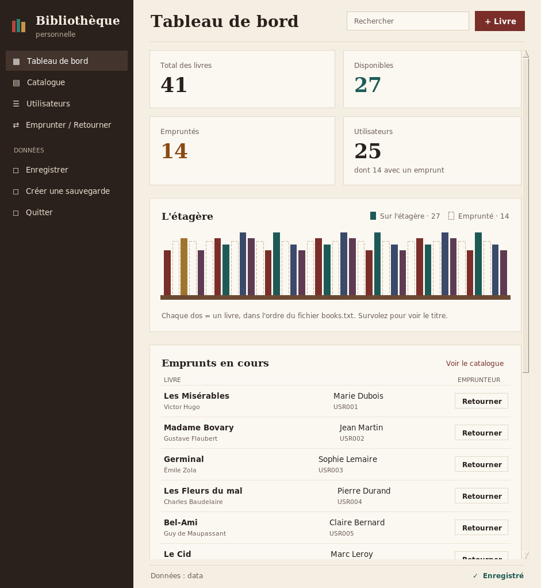
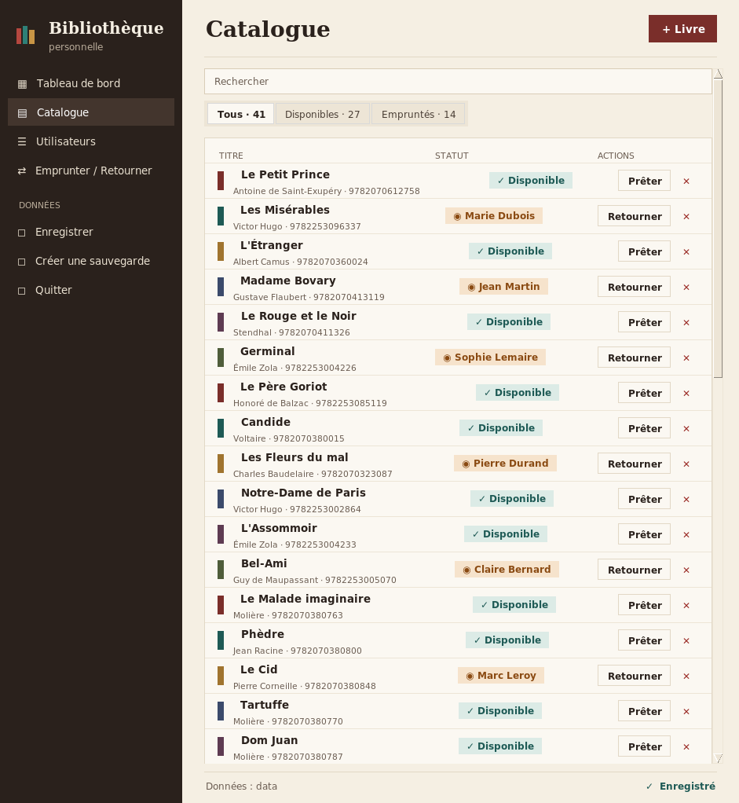

# Bibliothèque personnelle — application de bureau

Application de gestion d'une bibliothèque personnelle, construite autour du
modèle C++ original (`Book`, `User`, `Library`, `FileManager`).

L'interface graphique est une **application Python Tkinter native** (aucun
serveur web, aucun navigateur). Elle appelle le code C++ par **pybind11** :
le modèle, les recherches, les emprunts et la persistance restent en C++.

Le menu texte d'origine (`main.cpp`) est conservé et partage le même modèle et
les mêmes fichiers.

## Prérequis

- CMake ≥ 3.21 et un compilateur C++17 ;
- Python 3.11+ et Tkinter (`python3-tk`) ;
- les en-têtes pybind11 (`python3-pybind11` / `pybind11-dev`) ;
- un serveur X (`DISPLAY`), fourni par le dev container.

## Compiler

```bash
cmake -S agent -B agent/build -G Ninja
cmake --build agent/build
```

| Fichier produit | Rôle |
|---|---|
| `agent/build/bibliotheque` | interface texte (TUI) |
| `agent/build/biblio_core*.so` | module pybind11 importé par l'interface Tkinter |

## Lancer l'interface graphique

```bash
./agent/run_gui.sh                       # données agent/data
./agent/run_gui.sh -d /chemin/vers/data  # un autre dossier
```

Une fenêtre « Bibliothèque personnelle » s'ouvre. Sans `-d`, l'écran « Aucun
dossier de données » permet d'en choisir un.

Équivalent direct :

```bash
python3 agent/python/gui.py -d agent/data
```

## Lancer l'interface texte

```bash
./agent/build/bibliotheque -d agent/data
```

## Tests

```bash
# état + pybind11, sans affichage
python3 -m unittest agent.tests.test_store -v

# fenêtre Tkinter réelle, avec affichage
DISPLAY=:0 python3 -m unittest agent.tests.test_gui -v
```

`test_store` vérifie notamment que l'objet manipulé est bien un
`biblio_core.Library` (donc du C++ compilé, pas une réimplémentation Python).
`test_gui` construit la vraie fenêtre, ajoute un livre, l'emprunte, l'enregistre,
crée un utilisateur et ouvre les dialogues.

## Architecture

```
agent/
├── book.h/.cpp, user.h/.cpp, library.h/.cpp, filemanager.h/.cpp
│     modèle et persistance C++ d'origine
├── main.cpp                  interface texte (TUI)
├── bindings/module.cpp       exposition pybind11 -> biblio_core
├── python/
│   ├── store.py              état applicatif (via biblio_core), sans UI
│   └── gui.py                fenêtre Tkinter : six écrans, dialogues, actions
├── docs/
│   ├── specification-gui.md  cahier des charges de l'interface
│   ├── mockups/              les six écrans de la maquette (référence)
│   └── screenshots/          captures de l'application réelle
├── tests/
│   ├── fixtures/data/        copie du jeu de données de référence
│   ├── test_store.py         tests du modèle/état (pybind11)
│   └── test_gui.py           tests de la fenêtre Tkinter
└── CMakeLists.txt
```

## Aperçu





## Format des données

```
books.txt   titre|auteur|isbn|1|emprunteur
users.txt   nom|identifiant|isbn1,isbn2,...
```

Le jeu de données de référence (`tests/fixtures/data`) contient volontairement
une incohérence entre les deux fichiers (`Indiana` / `Corinne`, USR010) :
l'application la signale au chargement et propose de la corriger, conformément
à la spécification.
